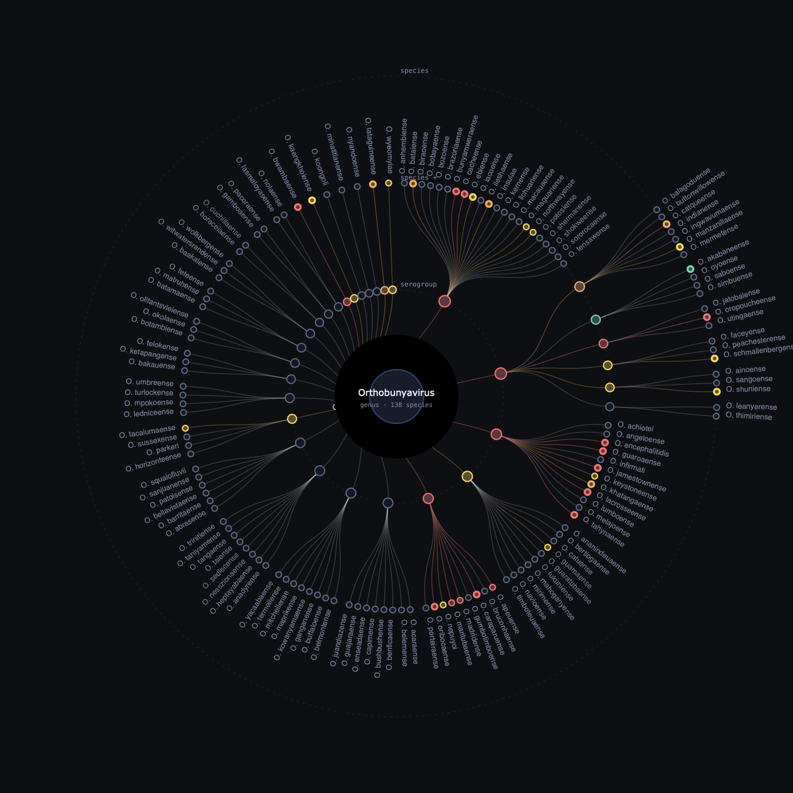
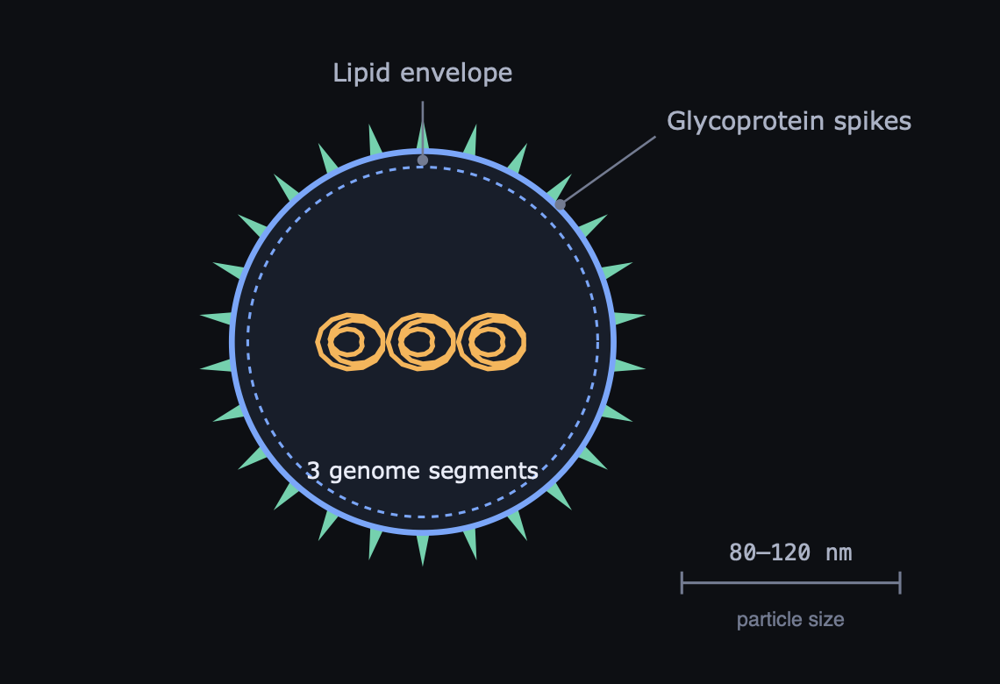
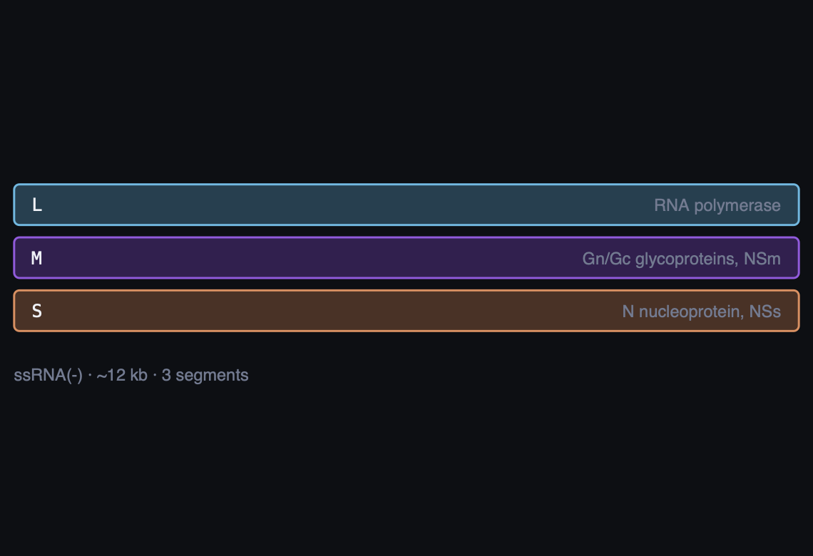
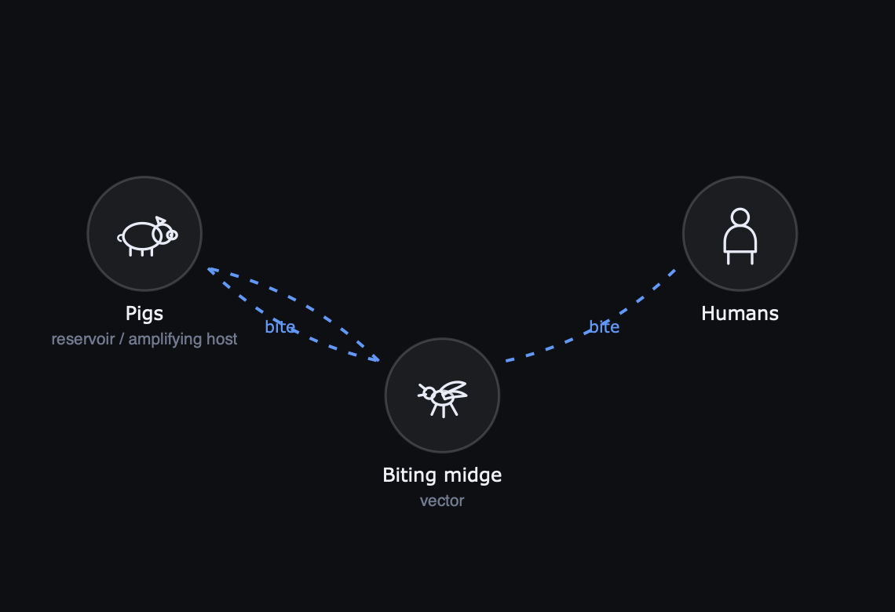
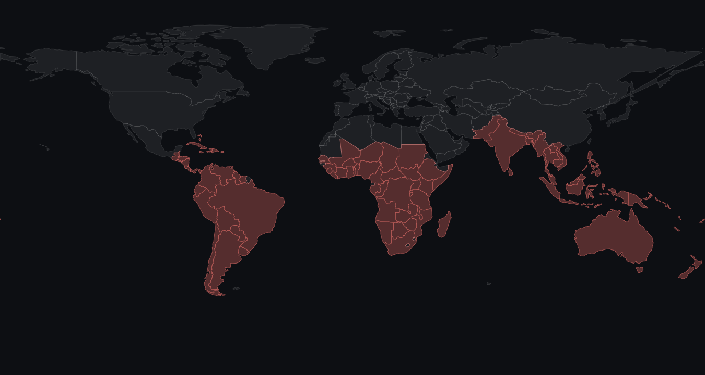
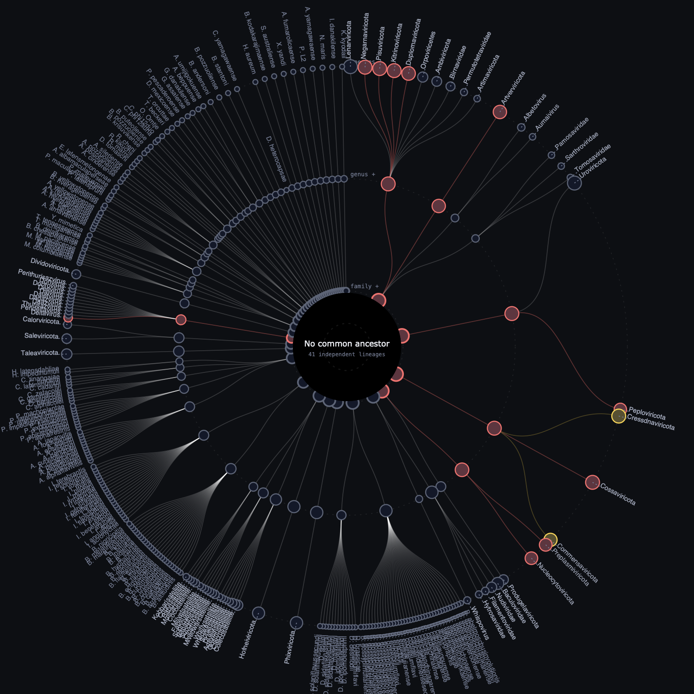

# Virus Atlas

> © 2026 **Saranga Sumathipala**. All rights reserved.
> Proprietary software and datasets — see [LICENSE](LICENSE). No licence is
> granted to use, copy, host, adapt or text-mine this work.

A Flask tree visualiser for the complete ICTV virus taxonomy, overlaid with
**serogroup assignments** and **human-pathogenicity evidence**.

Built as a learning tool: you can start from a virus you have just read about —
say Oya virus — and see immediately that it sits in *Orthobunyavirus
catqueense*, inside the **Manzanilla clade** of the **Simbu serogroup**,
alongside Oropouche, Akabane, Schmallenberg and Shuni viruses, with the
evidence for and against human pathogenicity laid out beside it.



*The radial view rooted on* Orthobunyavirus *— 138 species, serogroups on the
inner ring, coloured by evidence of human infection. Oya virus sits in the
Simbu serogroup's Manzanilla clade.*

## Screenshots

These are the application's own SVG output, rendered at 2× from a live page.
They are **not browser screenshots** — they were produced in a headless
environment with no browser, so the surrounding page chrome, typography and
layout are not shown. Colours and geometry are the app's; the soft hub glow
renders as a flat disc because the rasteriser does not support gradients.

| | |
| --- | --- |
|  |  |
| **Virion schematic.** Enveloped, glycoprotein-spiked, three genome segments — drawn from the family morphology spec and the segment count resolved from ICTV accessions. | **Genome organisation.** The L, M and S segments with their coding content. |
|  |  |
| **Transmission cycle.** Vector, amplifying host and human, drawn from the curated profile. | **Reported distribution.** Natural Earth geometry shaded from the curated country list. |



*The top of the taxonomy in* **split mode** *: 41 independent lineages, each in
its own wedge with a real gap, and nothing joined through the centre — because
ICTV realms share no demonstrated common ancestor. Drawing a single root there
would assert something the data does not support.*

## What it shows

**The tree** (left pane) is the full ICTV hierarchy — realm through species to
individual reference isolates, 17,554 species over 42,000 nodes. Two synthetic
levels are inserted between genus and species where the classical literature
defines them:

- **serogroup** — cross-neutralisation groups (Simbu, California, Bunyamwera,
  Group C, Guamá, the flavivirus serocomplexes, alphavirus complexes,
  arenavirus clades, hantavirus reservoir clades, nairovirus serogroups,
  lyssavirus phylogroups …)
- **antigenic clade** — finer sublineages, e.g. Manzanilla, Oropouche,
  Akabane, Sathuperi/Schmallenberg within the Simbu serogroup

Species that belong to a genus with serogroups but have no published
assignment land under *Unassigned within genus*, so nothing is hidden.

## Radial taxonomy tree

A circular cladogram of the ICTV hierarchy, built with D3 (vendored locally in
`static/vendor/`, so the app needs no network at runtime). Open it from
**Radial tree** in the toolbar; it roots itself on the genus of whatever you
have selected.

- each ring is an ICTV **rank**, labelled with the rank that dominates it
  (marked `+` where a ring mixes ranks, as serogroup/clade/species do)
- nodes are coloured and sized by evidence tier and species count, so branches
  carrying human pathogens are visible at a glance
- **click a branch** to re-root — nodes animate along their arcs from where
  they were, entering from their parent's old position, so the change is
  followable rather than a cut
- **click a tip** to open that species in the article panel
- **hover** traces the lineage back to the hub and dims everything else
- drag to pan, scroll to zoom, plus depth and branch-count controls
- when tips are too dense to label, the ones carrying evidence keep their
  labels and the rest appear on hover

Breadth is bounded server-side by `/api/subtree`: the largest children are kept
and the remainder folded into a `+N` marker, so nothing silently disappears.

**This is a taxonomy, not an inferred phylogeny.** Radius encodes rank depth
only — ICTV ranks are not sequence distances, so no branch length here means
anything evolutionary, and the view says so in its own footer.

## Figures

Every page is illustrated with SVG schematics drawn from the data — no bitmaps,
no stock art, so they stay sharp at any size and recolour with the theme.

- **Virion schematic** — a labelled cross-section of the particle: envelope,
  capsid symmetry, surface projections, nucleocapsid, genome segments, with a
  scale bar in nanometres. Ten particle morphologies are drawn (spherical,
  pleomorphic, icosahedral, bullet, filamentous, rod, brick, tailed phage,
  lemon, bottle) plus capsidless replicons. Architecture comes from
  `atlas/morphology.py`, a curated per-family layer: 94 families with a
  specific entry (63.7% of species, and every profiled species), the rest
  drawn generically from their genome type and labelled as such.
- **Genome map** — one coloured bar per segment or gene, annotated with
  genome type and approximate size. Oya virus shows its three bunyaviral
  segments: L (polymerase), M (Gn/Gc glycoproteins), S (N nucleoprotein).
- **Transmission cycle** — reservoir → vector → human, drawn from the recorded
  vectors and reservoir, with hand-drawn cartoons for mosquito, midge, tick,
  sandfly, bat, rodent, pig, bird, primate, cattle, sheep, horse, sloth and
  more. The diagram adapts to the route: arthropod-borne, rodent-excreta,
  bat-spillover with an intermediate host, respiratory, or direct contact,
  including a nosocomial loop where person-to-person spread is documented.
- **Distribution map** — a world choropleth shading the countries where the
  virus is reported, resolved from the prose distribution by `atlas/geo.py`.
  Geometry is Natural Earth 110m (public domain), decoded from TopoJSON into
  plain SVG paths at build time by `build_world.py`, so the browser needs no
  mapping library.

Figures appear on species, isolate, genus and family pages; architecture is a
family-level trait, so a family page illustrates the same particle its species
do. Captions are numbered Fig. 1, 2, 3 and state what the figure is and what it
cannot claim.

**The sidebar** gives the full briefing for whatever is selected. For a species
with a curated profile: clinical syndrome, transmission and ecology, vectors,
reservoir, distribution, incubation, diagnosis, management, prevention, the
numbered **evidence for human infection** (what was shown, and how), key
references with DOI/PubMed links, synonyms, classification and the ICTV isolate
table. For a family, genus, serogroup or clade: an orientation note, a
pathogenicity distribution bar across all species beneath it, the species that
do carry evidence, and the child taxa.

**Evidence tiers** colour every node in the tree, and each node inherits the
strongest tier beneath it, so you can see at a glance which branches matter for
human health:

| Tier | Meaning |
| --- | --- |
| Established | Isolated/amplified from symptomatic humans, accepted causal link |
| Probable | Human infection confirmed with compatible illness; causation unsettled |
| Possible | Serology only, or isolated case reports |
| Animal pathogen | Veterinary importance, no credible human disease |
| No human evidence | No vertebrate host in the ICTV record, so human infection is not expected |
| **Not assessed** | **Nobody here has looked. Not a finding.** |

The last two are different claims and used to be conflated. Until the tier
audit, every unprofiled species was labelled "no human evidence" — an
assertion of a negative finding for 17,000 species nobody had examined,
including measles, hepatitis B and RSV. `no-evidence` now means only what the
host range supports; everything else unexamined is `unassessed`, drawn dashed
and hollow so it cannot read as a result.

### How a tier is assigned

Every tier records **which layer decided it**, shown on the virus page:

| Basis | Species | What it means |
| --- | --- | --- |
| `profile` | 57 | A curated briefing, assessed against published evidence |
| `reference` | 285 | The human-pathogen reference list in `atlas/human.py` |
| `vmr-name` | 78 | ICTV's own record names human-derived isolates |
| `host-range` | 13,251 | No vertebrate host at all, so humans are not expected |
| `unassessed` | 3,883 | Not examined here |

### Correcting a tier

The curated layers are incomplete by construction, so any tier can be
corrected from the virus page. Corrections are stored in
`data/overrides.json` keyed by ICTV binomial, applied to the live tree
immediately, rolled up to every ancestor, and never touched by a rebuild —
`python -m atlas.update --check` reports any that a taxonomy change has
orphaned.

**Pathogen index** lists all 411 species whose tier says something about
human infection — not only the profiled ones — with a filter, since 411 is
too many to scan.

## Live literature for the unprofiled species

Only 57 species carry a hand-written profile. For every other species the
sidebar runs a **live Europe PMC lookup** the first time you open it, and
caches the result in `data/evidence.sqlite` so later visits are instant and
offline. No API key, no account, no third-party AI: every statement in the
panel is a citation you can open.

A Europe PMC search on the species
binomial plus every common virus name ICTV records for it. Papers are graded by
where the virus is actually named — title, abstract, or only a passing mention —
so broad reviews and annual taxonomy updates sink below the primary literature.
Each paper shows journal, year, citation count, an expandable abstract and
DOI/PMID/full-text links.

A paper is flagged **human infection** only when a virus name and a
human/clinical term occur in the *same sentence*. Flagging on "human" appearing
anywhere labelled an archaeal virus a human pathogen in testing; the
sentence-level rule fixes that. It stays a keyword heuristic, so treat the flag
as a pointer to read the paper, not as a finding.

Warm the cache ahead of time instead of on first view:

```bash
.venv/bin/python -m atlas.enrich "Orthobunyavirus shuniense"   # one species
.venv/bin/python -m atlas.enrich --genus Orthobunyavirus       # one genus
.venv/bin/python -m atlas.enrich --all --limit 500             # batch, resumable
```

A full run takes roughly 5–9 hours for all 17,554 species at polite rate
limits, so `--genus` is usually the sensible unit.

## Deploying

### Render (runs the real application)

The repository carries a [`render.yaml`](render.yaml) blueprint. Render builds
the atlas at deploy time rather than serving a committed copy, so a redeploy
picks up a new ICTV release.

Two constraints shape the configuration, both on the free plan:

* **One worker, not more.** The process holds the parsed atlas in memory, about
  165 MB resident, against a 512 MB limit. A second worker would load a second
  copy and the service would be OOM-killed. Concurrency comes from threads
  instead, which suits work that is I/O-bound on upstream APIs.
* **No persistent disk.** The filesystem is restored from the build on every
  restart, and the service sleeps after 15 minutes idle. Tier corrections are
  therefore lost when it wakes. `EPHEMERAL_STORAGE=1` makes the interface say
  so rather than implying they are saved.

### GitHub Pages (a static snapshot)

Pages serves files, not programs, so `python export_static.py` writes a
`site/` directory: the same front end plus pre-rendered JSON, and a `fetch`
interceptor (`static/js/static-api.js`) that answers `/api/...` from those
files. 40 MB in 1,589 files, sharded by family — or by genus, in the lineages
ICTV leaves without one — so a page load fetches a few kilobytes rather than
the whole atlas. Isolates are not written at all: their metadata is already
in the species record, so the browser rebuilds them from it.

The live sources keep working, because Europe PMC, WHO, gov.uk and Nextstrain
all send `access-control-allow-origin: *` — the browser calls them directly.
What changes is that tier corrections go to `localStorage`, so they are
per-browser and unshared; nothing is cached between reloads; and the weekly
ECDC threat-report link is absent, that being the one source that sends no
CORS header and so cannot be read from a page at all.

Everything else is answered exactly as Flask answers it, and `tests/parity.js`
holds it to that: it drives both builds and diffs the JSON field by field.
It exists because they had drifted badly without anyone noticing — the hosted
copy was serving a trimmed record for every family, so a family page lost its
virion figure and its roster of pathogenic species; 2,611 species in the
family-less Caudoviricetes lineages were in no file at all and answered "not
found"; and no isolate appeared anywhere. Every suite had only ever been run
against Flask.

## Running it

```bash
python3 -m venv .venv
.venv/bin/pip install -r requirements.txt

.venv/bin/python fetch_vmr.py      # download the current ICTV VMR spreadsheet
.venv/bin/python build_world.py    # bake the world map into SVG paths
.venv/bin/python -m atlas.build    # build data/atlas.json  (~37 MB, a few seconds)

python3 app.py                     # http://127.0.0.1:5057
```

The last line works with the plain system `python3`: `app.py` notices that
Flask is missing, hands over to `.venv/bin/python` and carries on. Only when
run as a script, so a WSGI server importing `app:app` is unaffected.

`fetch_vmr.py` scrapes the ICTV download page for the newest Master Species
List, so re-running the three commands after an ICTV ratification refreshes the
whole atlas. `data/atlas.json` and `data/evidence.sqlite` are build/cache artefacts and are
gitignored.

Keyboard: `/` focuses search, arrows move through results, Enter opens,
Escape closes.

## Layout

```
app.py                  Flask app; lazy tree API, search, pathogen index
fetch_vmr.py            downloads the newest ICTV VMR spreadsheet
atlas/build.py          VMR spreadsheet -> data/atlas.json
atlas/morphology.py     virion architecture per family          (curated)
atlas/geo.py            prose distribution -> map countries     (curated)
build_world.py          Natural Earth TopoJSON -> SVG paths
atlas/enrich.py         live Europe PMC lookup, SQLite cache
atlas/serogroups.py     serogroup + antigenic clade assignments  (curated)
atlas/profiles.py       human-pathogenicity profiles, taxon notes (curated)
templates/index.html
static/css/app.css      light + dark themes
static/js/app.js        tree, search, sidebar rendering
static/js/figures.js    SVG figure engine + organism cartoons
static/js/radial.js     D3 radial cladogram
static/vendor/d3.v7.min.js   vendored, so the app runs offline
static/data/world.json  baked country paths (129 KB, built once)
```

The tree is served lazily — `/api/children` returns one level at a time, so the
35 MB dataset never reaches the browser. `/api/node` returns the full record
plus ancestry for deep-linking from a search hit.

### Adding a virus profile

Append a `profile(...)` call in `atlas/profiles.py`, keyed by the exact ICTV
species binomial, and rebuild. The build prints how many profiles matched a
species; a typo shows up as a lower count. To extend serogroups, add epithets
(the second word of the binomial) to `SEROGROUPS` in `atlas/serogroups.py`.

## Interface

The chrome follows the materials of modern desktop software: translucent,
blurred, saturated panels over a tinted backdrop (Apple's vibrancy), a Fluent
reveal highlight that follows the pointer across interactive surfaces, layered
elevation with a hairline top edge-light, and spring easing on state changes.
Type is the host system's own ramp — SF Pro on macOS, Segoe UI Variable on
Windows — with Apple's New York for the editorial serif where available.

Motion is used where it carries meaning: transmission arrows flow in the
direction of spread, radially symmetric virions turn slowly, map countries wash
in, and the radial tree animates between roots. Everything collapses under
`prefers-reduced-motion`.

## Per-virus data layers

Beyond the profile, each species page carries whatever of these applies:

- **Antiviral therapy & evidence** (19 viruses) — guideline links, licensed
  agents, phase 2/3 data with NCT numbers, investigational agents. Graded by
  evidence quality rather than by how widely a drug is used, which is why
  tecovirimat appears as *conflicting* (PALM007 and STOMP both failed) and
  remdesivir likewise. 69 verified references.
- **Receptor & cell tropism** (39) — entry receptors kept separate from
  attachment factors, plus why the receptor explains the disease.
- **Biosafety & containment** (71) — BSL, WHO risk group, US select-agent
  status, worker vaccination, and the reasoning behind the level.
- **Vaccines & antivirals** (48) — including the explicit absence of them.
- **Serological cross-reactivity** (10 complexes) — what cross-reacts, what it
  does to interpretation, what resolves it. Also on genus and serogroup pages.
- **Baltimore group** — derived mechanically from the ICTV genome field, so all
  17,554 species have one.
- **Genomic epidemiology** — Nextstrain builds, with size, build date and
  composition. The trees are not proxied: they belong to Nextstrain and are
  linked out.

## Other views

- **Travel exposure** — viruses reported from a destination, grouped by
  exposure route, with incubation windows filtered against days since return.
  239 destinations, which is wider than the 177 the map can draw: small island
  states have no Natural Earth polygon and are carried separately in
  `atlas/geo.py:OFFMAP`.
- **Differential by presentation** — 16 syndromes over 174 species, narrowed
  by destination, route and time since return. A keyword match over curated
  prose, not a clinical decision aid.
- **Signals** — WHO Disease Outbreak News, matched to the taxonomy where
  possible. A record of what WHO has reported, not incidence.

## Keeping it current

```
python -m atlas.update --check        # what is stale; changes nothing
python -m atlas.update --taxonomy     # fetch the current ICTV VMR and rebuild
python -m atlas.update --live         # refresh WHO and Nextstrain caches
python -m atlas.update --check-refs   # verify every citation
```

The taxonomy rebuild diffs species and then reports every curated key and
every tier correction that no longer matches — the failure mode that actually
bites, since the curated layers are keyed by binomial and ICTV renames
species between releases. `atlas.build` additionally reports serogroup
epithets that match no species, after an audit found 28 of them failing
silently.

## Sources and caveats

Taxonomy and isolate records come from the
[ICTV Virus Metadata Resource](https://ictv.global/vmr) (MSL41).

Serogroups and pathogenicity profiles are a **curated layer, not part of
ICTV** — ICTV taxonomy stops at species and takes no position on serogroups or
clinical significance. Profiles cite primary literature and WHO/CDC/ECDC
sources where available.

Absence of a profile means the atlas has nothing on record — not that a virus
cannot infect humans. Of 17,554 ICTV species, 57 carry a full profile and 285
more a reference-list tier; the rest are shown with their ICTV host range plus
the live Europe PMC literature lookup.

Geographical data carries its own provenance. A country is marked **stated**
when the curated range names it and **inferred** when it was reached by
expanding a region phrase — because expanding prose over-reaches: "Central and
South Asia" put Crimean-Congo haemorrhagic fever in Sri Lanka, which has never
reported a case. 17 high-traffic viruses now carry explicit country lists that
override the prose.

Country entries also carry an **evidence grade**: human cases reported, human
seroprevalence only, reservoir detection only, or competent vector present.
Nipah virus in Sri Lankan *Pteropus* bats is present in the country with no
human case ever reported, and saying so is different from either hiding the
finding or implying a human risk.

Every therapeutic claim carries a PMID, and all of them are machine-verified
against Europe PMC by `python -m atlas.update --check-refs`. This check exists
because the first draft of that layer used recalled identifiers and most of
them resolved to unrelated papers. A resolving PMID shows the paper exists and
is cited correctly — not that it supports the claim.

All figures are **schematics drawn from these data, not micrographs**. The
virion drawings show the architecture a textbook would, at representative
proportions — they are not to scale against each other, and the scale bar
states the real size instead. Distribution maps shade reported range, not
surveillance intensity.

**Educational reference. Not clinical guidance, and not a diagnostic tool.**
